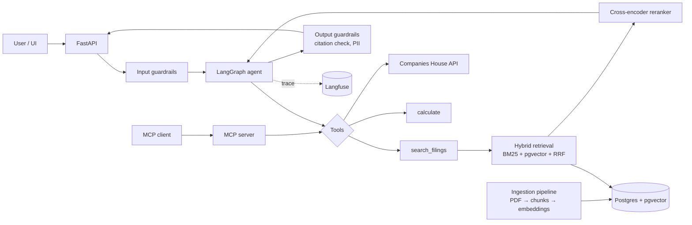

# UK Filings Analyst

**An evaluated, production-style RAG + agent system for question answering over UK listed companies' annual reports — with cited answers, tool-calling, an MCP server, guardrails, observability and CI-gated evaluation.**

> Ask: *"Compare Tesco and Sainsbury's revenue growth over the last three financial years and explain the main drivers."*
> Get: a multi-step answer with page-level citations, computed figures, and a full trace of every retrieval and tool call.

  

---

## Why this project

Most RAG demos stop at "it answers questions". Real teams need to know **how well** it answers, **what it costs**, **when it fails**, and **whether a change made it worse**. This project treats those as first-class features:

- **Grounded answers** — every claim cites a document and page; the system declines when the answer isn't in the filings.
- **Measured, not assumed** — a hand-built golden dataset and an evaluation harness compare retrieval and generation strategies with real numbers.
- **Regression-safe** — every pull request runs the evaluation suite in CI; a drop in quality blocks the merge.
- **Observable** — every request is traced (latency, tokens, cost) in Langfuse.
- **Secure by design** — prompt-injection defences, PII filtering and output validation.

Data is fully public: annual report PDFs published by FTSE companies and the free Companies House API.

---

## Features

| Area | What it does |
|---|---|
| **Ingestion** | Parses annual-report PDFs (text + tables), cleans headers/footers, chunks with metadata (company, year, section, page). |
| **Hybrid retrieval** | BM25 + dense vectors (pgvector) fused with Reciprocal Rank Fusion, then a cross-encoder reranker. Metadata filters by company/year. |
| **Cited generation** | Answers with inline `[Company, Year, p.X]` citations; structured output validated with Pydantic; "not found" refusal path. |
| **Agent** | LangGraph agent that plans multi-step questions and calls tools: `search_filings`, `get_company_profile` (Companies House API), `calculate` (safe arithmetic for growth rates/ratios). |
| **MCP server** | The same tools exposed via the Model Context Protocol, usable from any MCP client (e.g. Claude Desktop). |
| **Evaluation** | Golden dataset (~100 Q&A), retrieval metrics (Recall@k, MRR), generation metrics (faithfulness, citation accuracy, answer correctness via LLM-as-judge calibrated against human labels), ablation experiments. |
| **Observability** | Langfuse tracing of every LLM call, retrieval and tool call; per-request cost and latency dashboards. |
| **Guardrails** | Prompt-injection detection on retrieved content and user input, PII redaction, tool-argument validation, rate limiting. |
| **Engineering** | FastAPI service, Docker Compose stack, GitHub Actions (lint, tests, eval gate), cloud deployment. |

---

## Architecture



---

## Evaluation results

> Numbers below are filled in from `eval/results/` after each experiment run. Golden set: _N_ questions across _M_ companies, 3 question types (factual lookup, numeric extraction, multi-hop comparison).

### Retrieval

| Configuration | Recall@5 | MRR | Latency p95 |
|---|---|---|---|
| Dense only, 512-token chunks | _tbd_ | _tbd_ | _tbd_ |
| Dense only, 1024-token chunks | _tbd_ | _tbd_ | _tbd_ |
| Hybrid (BM25 + dense, RRF) | _tbd_ | _tbd_ | _tbd_ |
| Hybrid + reranker | _tbd_ | _tbd_ | _tbd_ |

### End-to-end answers

| Configuration | Faithfulness | Citation accuracy | Answer correctness | Cost / query |
|---|---|---|---|---|
| Single-shot RAG | _tbd_ | _tbd_ | _tbd_ | _tbd_ |
| Agent (multi-step) | _tbd_ | _tbd_ | _tbd_ | _tbd_ |

### Guardrails

| Test set | Cases | Blocked / handled correctly |
|---|---|---|
| Prompt-injection (planted in documents + user input) | _tbd_ | _tbd_ |
| Unanswerable questions (should refuse) | _tbd_ | _tbd_ |

### Failure analysis

_To be written after experiments: the main failure categories (e.g. table extraction errors, cross-year confusion, wrong fiscal-year mapping), examples, and the fixes that were tried._

---

## Tech stack

**Language & API:** Python 3.11, FastAPI, Pydantic
**LLM & agent:** Claude / OpenAI API (configurable via LiteLLM), LangGraph
**Retrieval:** PostgreSQL + pgvector, BM25 (rank-bm25), bge-reranker / Cohere Rerank, embeddings (OpenAI `text-embedding-3-small` or `bge-small-en`)
**Parsing:** PyMuPDF, pdfplumber (tables)
**Protocols:** Model Context Protocol (official Python SDK)
**Evaluation & observability:** custom eval harness, LLM-as-judge, Langfuse
**Infra:** Docker Compose, GitHub Actions, Azure Container Apps (or GCP Cloud Run)
**Quality:** pytest, ruff, mypy

---

## Repository structure

```
uk-filings-analyst/
├── app/
│   ├── api/            # FastAPI routes (/ask, /health, /ingest)
│   ├── agent/          # LangGraph graph, state, prompts
│   ├── tools/          # search_filings, companies_house, calculate
│   ├── retrieval/      # bm25, dense, fusion, reranker
│   ├── guardrails/     # injection detection, PII, output checks
│   ├── llm.py          # model client wrapper (LiteLLM)
│   └── config.py
├── ingestion/          # PDF parsing, cleaning, chunking, embedding
├── mcp_server/         # MCP server exposing the tools
├── eval/
│   ├── golden/         # golden_set.jsonl, injection_set.jsonl
│   ├── metrics.py      # recall@k, MRR, faithfulness, citation accuracy
│   ├── run_eval.py     # runs a configuration, writes results/
│   └── results/
├── data/               # raw PDFs (gitignored) + manifest.csv
├── tests/
├── docker-compose.yml  # api + postgres/pgvector + langfuse
├── .github/workflows/  # ci.yml (lint, test, eval gate)
└── README.md
```

---

## Quick start

```bash
git clone https://github.com/jiebai0110/uk-filings-analyst.git
cd uk-filings-analyst
cp .env.example .env          # add LLM API key + Companies House API key
docker compose up -d          # api, postgres+pgvector, langfuse
python -m ingestion.run --manifest data/manifest.csv
curl -X POST localhost:8000/ask -H "Content-Type: application/json" \
     -d '{"question": "What was Tesco group revenue in FY2024?"}'
```

Run the evaluation suite:

```bash
python -m eval.run_eval --config configs/hybrid_rerank.yaml
```

Use the tools from an MCP client:

```bash
python -m mcp_server.server   # then register it in your MCP client config
```

---

## Design decisions

- **Hybrid retrieval over dense-only:** annual reports are full of exact terms (segment names, metric names, fiscal years) where lexical matching outperforms embeddings; the eval table quantifies this.
- **Citations are validated, not trusted:** the output guardrail checks that each cited page actually contains supporting text, and downgrades or removes unsupported claims.
- **Arithmetic is delegated to a tool:** the LLM never computes growth rates itself — a deterministic calculator does, which removes a whole class of numeric hallucinations.
- **Eval in CI:** a small, fast subset of the golden set runs on every PR with a cost cap; the full set runs nightly.

## Limitations & next steps

- Table extraction from complex PDF layouts remains the weakest step.
- LLM-as-judge is calibrated on a sample of human labels, but not a substitute for them.
- Next: GraphRAG over subsidiaries/officers from Companies House; fine-tuned small reranker; streaming responses.

---

## Licence

MIT. Annual reports remain the property of their publishers and are used for non-commercial research; they are not redistributed in this repository.
